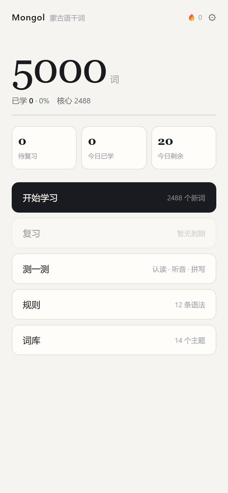

# Mongol · 拉丁蒙古文词库

用拉丁字母学蒙古语：**5000 词 · 五语对照 · 发音 · 间隔重复**。

纯静态网页，没有后端、没有账号，学习记录存在浏览器本地。



## 是什么

蒙古语现在写西里尔字母，传统蒙文（回鹘蒙文）是竖排的。这个项目用**拉丁转写**当入口，
让不懂蒙文字母的人也能先把词读出来、背下来。

每个词显示五样东西：

```
latin         khün          拉丁转写（主）
汉语           人           中文释义
英文           person       英文
西里尔          хүн          Cyrillic
回鹘蒙文        ᠬᠦᠮᠦᠨ       竖排传统蒙文
```

转写方案：`х→kh  ц→ts  ч→ch  ш→sh  ө→ö  ү→ü`

## 功能

| 页面 | 做什么 |
|---|---|
| 学习 | 卡片式，自动发音，一次 20 词（可调） |
| 复习 | SM-2 间隔重复：忘记 / 模糊 / 记得 / 简单 |
| 测一测 | 认读（看词选义）· 听音（听音选词）· 拼写（看义拼词） |
| 规则 | 12 条语法：字母、元音和谐、六个格、时态、语序、常用句型 |
| 词库 | 14 主题、搜索、筛选（全部 / 未学 / 已学 / 待复习）、导出 JSON |
| 设置 | 学习范围、每日新词量、自动发音、清空进度 |

- **5000 词**分两层：核心 2488（手写 + 词频筛选）、扩展 2512（词典补充）
- **5000 条语音**，离线可用
- **PWA**：可以装到手机主屏，断网也能学
- **响应式**：手机单列，桌面带侧边栏

## 本地运行

直接双击 `index.html` 就能用（字体和音频都在本地）。

想装成 PWA 才需要起服务器：

```bash
python -m http.server 8080
# 打开 http://127.0.0.1:8080
```

## 部署到 GitHub Pages

1. 在 GitHub 新建一个仓库（比如 `mongol-latin`），不要初始化 README
2. 本地执行：

```bash
git init
git add .
git commit -m "init"
git branch -M main
git remote add origin https://github.com/<你的用户名>/mongol-latin.git
git push -u origin main
```

3. 仓库页 → **Settings → Pages**
4. Source 选 **Deploy from a branch**，Branch 选 **main**，目录选 **/ (root)**，保存
5. 等 1–2 分钟，访问 `https://<你的用户名>.github.io/mongol-latin/`

`.nojekyll` 已经有了，不用另加。音频文件多（5000 个、49MB），第一次 push 会慢一点。

## 目录

```
index.html              入口
manifest.webmanifest    PWA 清单
sw.js                   Service Worker（离线缓存）
assets/style.css        样式（内嵌蒙古文字体，保证任何设备都能显示）
assets/app.js           全部逻辑（视图 / SM-2 / 测验 / 设置）
data/words.js           词库 5000 词
data/rules.js           语法 12 条
audio/*.mp3             5000 条发音，文件名 = 词的 sha1 前 12 位
tools/                  构建脚本（见下）
```

## 重新生成词库

```bash
node tools/build-words.mjs   # 合并词表 → data/words.js
python tools/tts.py          # 生成缺失的音频（需 pip install edge-tts）
```

词表源在 `tools/words.src.js` 和 `tools/words.extra*.js`，改完重跑即可。
`tools/build-import.mjs` 负责从蒙汉词典挑词（需要 `data/src/mn-zh.json`，未随仓库提供）。

## 数据来源

- 回鹘蒙文部分来自 [khudam](https://github.com/bigune/khudam)（代码 MIT / 词典数据 CC BY-SA 4.0）
- 扩展词条来自公开蒙汉词典
- 语音由 Azure 蒙古语神经语音（`mn-MN-YesuiNeural`）合成

## 许可

代码 MIT。词库内容请遵守上游数据许可。
